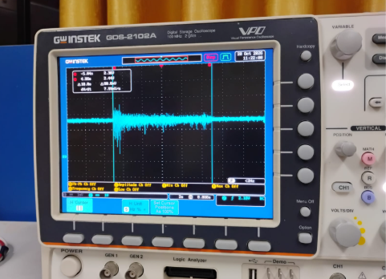

# Simulador de Señales sEMG de 8-Bits con ESP32

[](LICENSE)
[](https://www.python.org/)
[](https://www.arduino.cc/)
[](https://www.espressif.com/)
[](https://physionet.org/content/grabmyo/1.0.2/)

Un simulador por hardware de electromiografía de superficie (sEMG) desarrollado para la asignatura de **Instrumentación Biomédica I**. El sistema procesa registros biomédicos reales extraídos de la base de datos pública **GRABMyo** (PhysioNet), los escala al rango dinámico de 8 bits del DAC de un microcontrolador **ESP32** y los reproduce en tiempo real a una frecuencia de muestreo de **2048 Hz**.

Este módulo sirve como generador de prueba estándar y repetible para la etapa de acondicionamiento analógico (amplificadores de instrumentación y filtros) desarrollada en laboratorios posteriores.

---
##  Características
- **Base de datos:** PhysioNet (GRABMyo, Participante 1, Canal F12).
- **Secuencia:** 15 segundos (Reposo -> Cierre de mano -> Extensión de índice).
- **Resolución:** Escalado lineal de 8 bits (0-255).
- **Hardware:** ESP32-WROOM (DAC en GPIO25).

##  Estructura del Repositorio
- `colab/`: Código en Python para procesamiento, escalado y visualización.
- `src/`: Firmware en C++ para Arduino IDE y archivo de cabecera `semg.h`.

##  Requisitos
- ESP32 Dev Module
- Arduino IDE con soporte para ESP32
- Python 3 / Google Colab (`wfdb`, `numpy`, `matplotlib`)

## 👨‍💻 Autor y Contacto

- **Estudiante:** Ingeniería Biomédica (Universidad Nacional Mayor de San Marcos)
- **LinkedIn:** [linkedin.com](https://www.linkedin.com/)
- **Correo Electrónico:** @unmsm.edu.pe)

---
## 📐 Arquitectura del Sistema

```text
┌───────────────────────┐
│ Base de Datos GRABMyo │
└───────────┬───────────┘
            │
            ▼
┌───────────────────────┐
│ Google Colab (Python) │ ───► Lectura, Concatenación y Escalado a 8-bits [0 - 255]
└───────────┬───────────┘
            │
            ▼
┌───────────────────────┐
│        semg.h         │ ───► Matriz de 30,720 muestras guardada en Flash
└───────────┬───────────┘
            │
            ▼
┌───────────────────────┐
│ ESP32 (Firmware C++)  │ ───► Reproducción no bloqueante vía micros() a Fs = 2048 Hz
└───────────┬───────────┘
            │
            ▼
┌───────────────────────┐
│  DAC Salida (GPIO25)  │ ───► Señal analógica continua evaluada en Osciloscopio
└───────────────────────┘
```

## 📊 1. Procesamiento de la Señal (Python / Google Colab)

A partir del dataset **GRABMyo**, se seleccionó al **Participante 1 (Sesión 1, Canal F12)** y se extrajeron 3 gestos musculares de 5 segundos cada uno:

1. **Reposo (Gesto 17):** Línea base con mínima actividad electromiográfica (ruido muscular).
2. **Cierre de mano (Gesto 16):** Máxima respuesta de amplitud pico a pico por amplio reclutamiento de unidades motoras.
3. **Extensión del índice (Gesto 9):** Respuesta de amplitud intermedia.

### Escalado y Exportación
- **Concatenación:** Se formó una secuencia continua de **15 segundos** de duración (*Reposo -> Cierre de mano -> Extensión de índice*) que suma **30,720 muestras** a Fs = 2048 Hz.
- **Escalado lineal único:** Se aplicó una transformación lineal sobre el global de la señal para mapear los voltajes reales al entero de 8 bits [0, 255], conservando la proporción fisiológica entre cada gesto.
- **Exportación:** Se generó la cabecera `semg.h` almacenando la matriz `SEMG[]` en memoria Flash (`const uint8_t`).

---


## 💻 2. Firmware y Reproducción por DAC (ESP32)

El programa cargado al ESP32 utiliza el periférico DAC interno (**GPIO25 / DAC1**). Para cumplir estrictamente con la tasa de reproducción de 2048 Hz, se calcula un período de actualización de:

T = 1 / 2048 Hz = 488.28 us (redondeado a 488 us)

El código evita el uso de `delay()` empleando temporización acumulativa no bloqueante mediante `micros()`, eliminando cualquier desfase o error acumulado por tiempo de instrucción del bucle:

```cpp
#include "semg.h"

#define DAC_PIN 25  // DAC1 del ESP32
const unsigned long PERIODO_US = 488; 

uint16_t indice = 0;
unsigned long tiempoSiguiente = 0;

void setup() {
  tiempoSiguiente = micros() + PERIODO_US;
}

void loop() {
  if (micros() >= tiempoSiguiente) {
    dacWrite(DAC_PIN, SEMG[indice]);
    indice++;
    
    if (indice >= N_SEMG) {
      indice = 0; // Reinicio en bucle continuo de 15 segundos
    }
    
    tiempoSiguiente += PERIODO_US; // Acumulación limpia del período
  }
}
```
## 🔬 3. Verificación Experimental en Osciloscopio

La validación del hardware se realizó conectando el canal 1 del osciloscopio digital al pin de salida **GPIO25 (DAC1)** y la referencia a **GND** del ESP32.

| Vista Macro (Secuencia Completa 15 s) | Vista Micro (Zoom a Muestra ~0.49 ms) |
| :---: | :---: |
|  |  |
| *Escala: 2 s/div o 5 s/div. Se observa la secuencia periódica de 15 s (Reposo → Cierre → Extensión).* | *Escala: 100 µs/div. Retención de orden cero con retardo medido de ~0.49 ms a 2048 Hz.* |

---
